# TerraNova - 지구 환경·재해 대응 시뮬레이터

[](https://github.com/ryushin01/TerraNova/actions/workflows/ci.yml)


3D 지구 위에서 해수면 상승, 화산 분화, 쓰나미, 지진, 소행성 충돌, 태양 폭풍, 산불·가뭄을 일으키고 해협 댐·우주 차양·행성 방위 요격망 같은 거대 구조물로 막아 보는 웹 시뮬레이터입니다.

**[데모 바로 보기](https://ryushin01.github.io/TerraNova/)** · [Storybook](https://ryushin01.github.io/TerraNova/storybook/)

> **프로젝트 상태:** 1.0.0으로 정식 공개한 **개인 프로젝트**입니다. 해수면 상승은 실제 고도 자료(NOAA ETOPO1, 한반도는 1분 해상도)로 계산하지만, 도시 고도·인구·피해 규모는 대략값과 단순화한 모델이라 교육·탐색용으로만 쓰세요.

## 화면

| 첫 화면 (한국 정오)                                                                                        | 해수면 +25m (남아시아)                                                                                  |
| ---------------------------------------------------------------------------------------------------------- | ------------------------------------------------------------------------------------------------------- |
| 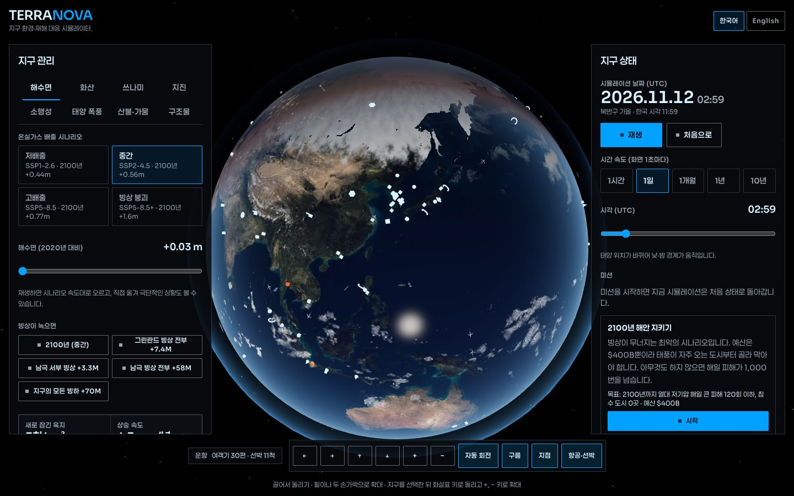 | 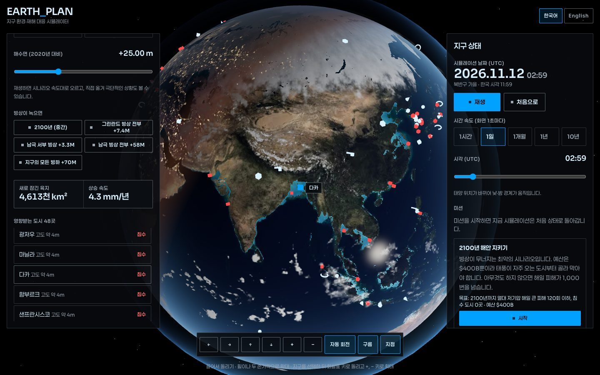 |

| 일본 해구 쓰나미                                                                                           | 백두산 VEI 7 분화 (밤)                                                                                       |
| ---------------------------------------------------------------------------------------------------------- | ------------------------------------------------------------------------------------------------------------ |
| 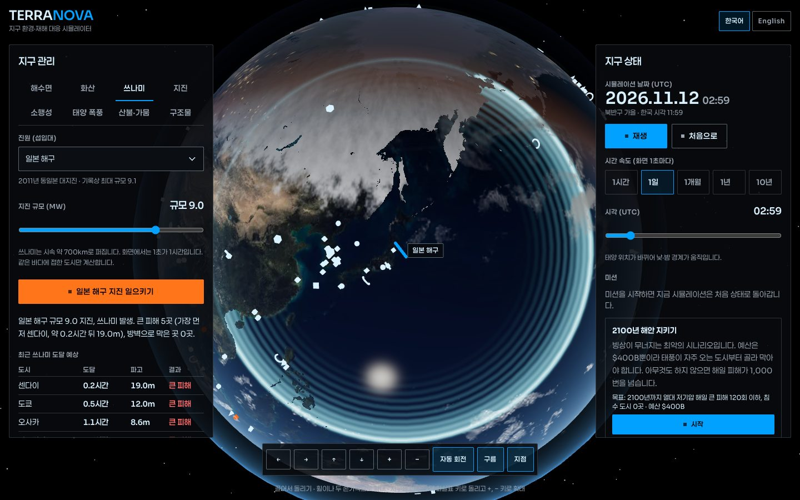 | 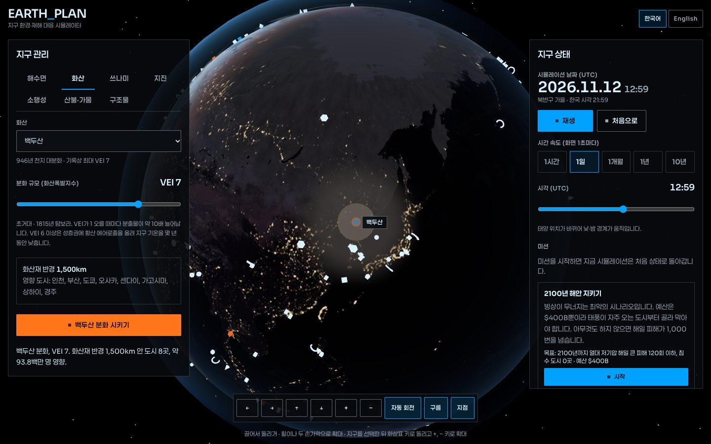 |

| 북대서양 소행성 충돌 (지름 1km)                                                                          | 캘리포니아 극심 가뭄과 산불 (밤)                                                          |
| -------------------------------------------------------------------------------------------------------- | ----------------------------------------------------------------------------------------- |
| 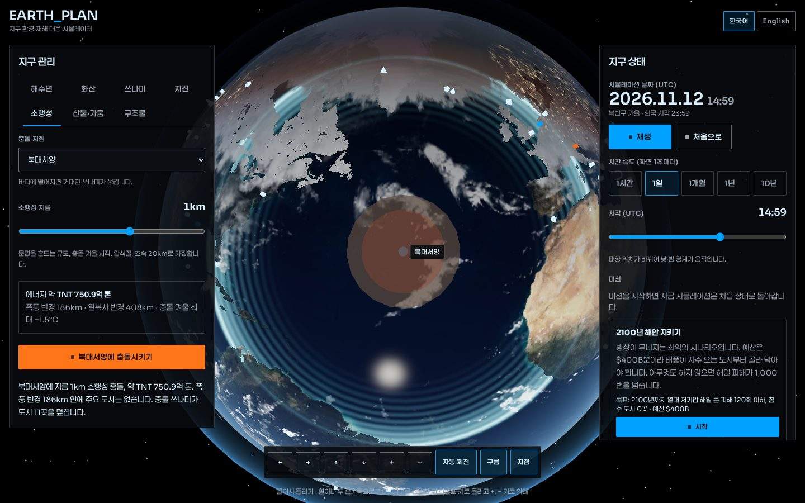 | 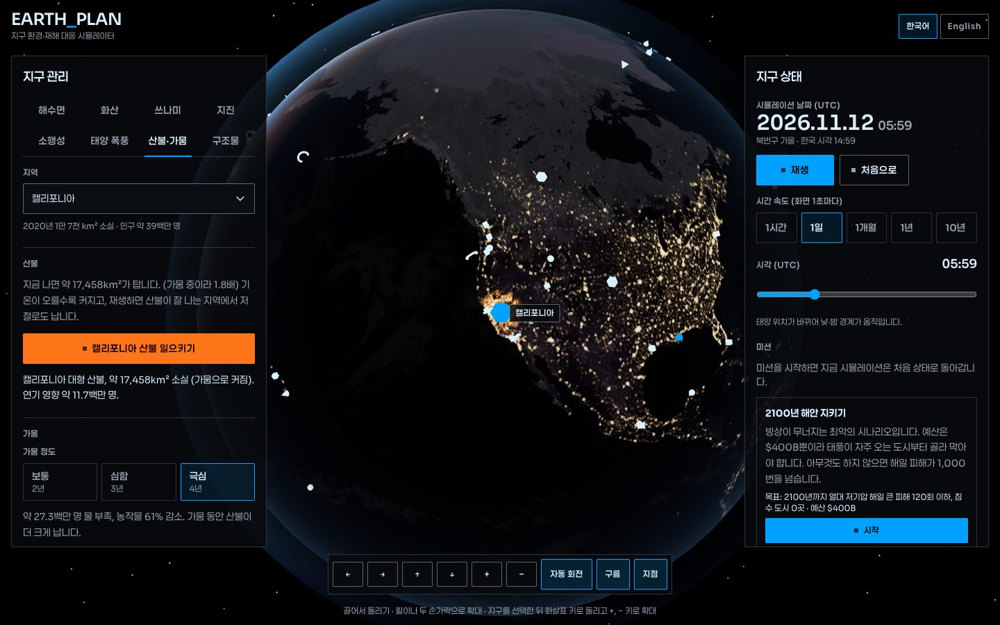 |

| 북해 차단 댐 건설                                                                                   | 빙상 붕괴 미션과 추이 그래프                                                                                               |
| --------------------------------------------------------------------------------------------------- | -------------------------------------------------------------------------------------------------------------------------- |
| 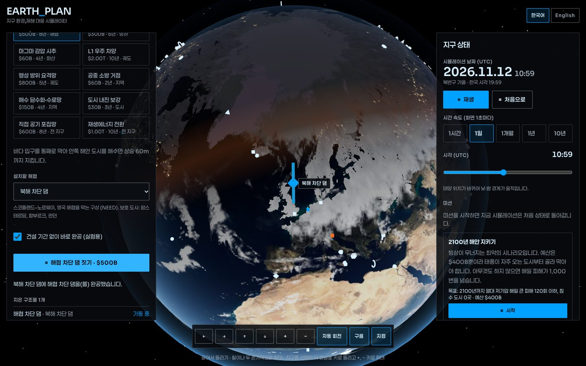 | 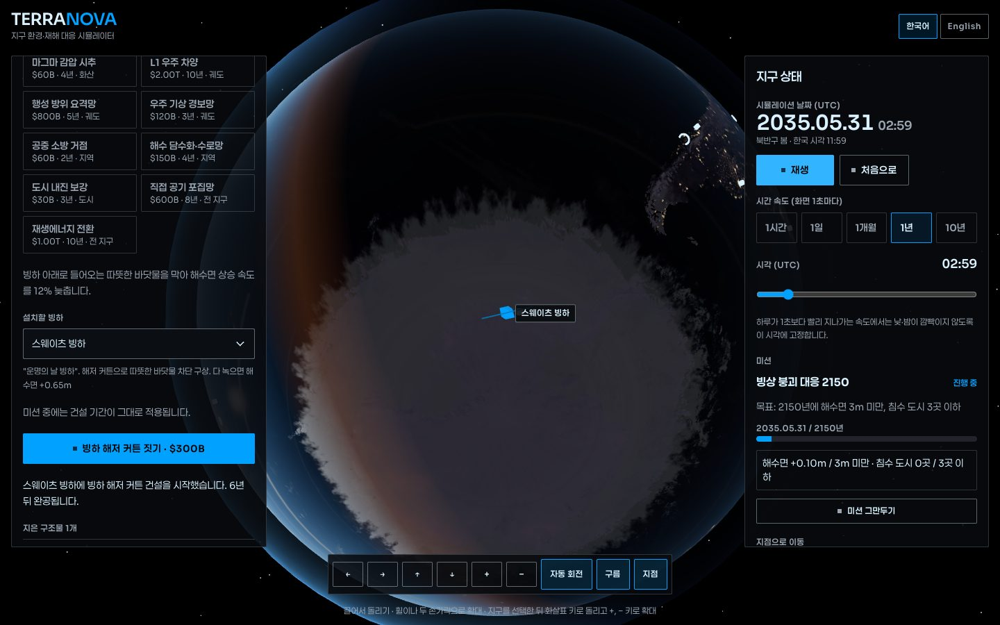 |

| 캐링턴급 태양 폭풍 (유럽 밤 오로라)                                                                                                                 | 해수면 +12m 한반도 (1분 고해상도 고도)                                                                       |
| --------------------------------------------------------------------------------------------------------------------------------------------------- | ------------------------------------------------------------------------------------------------------------ |
| 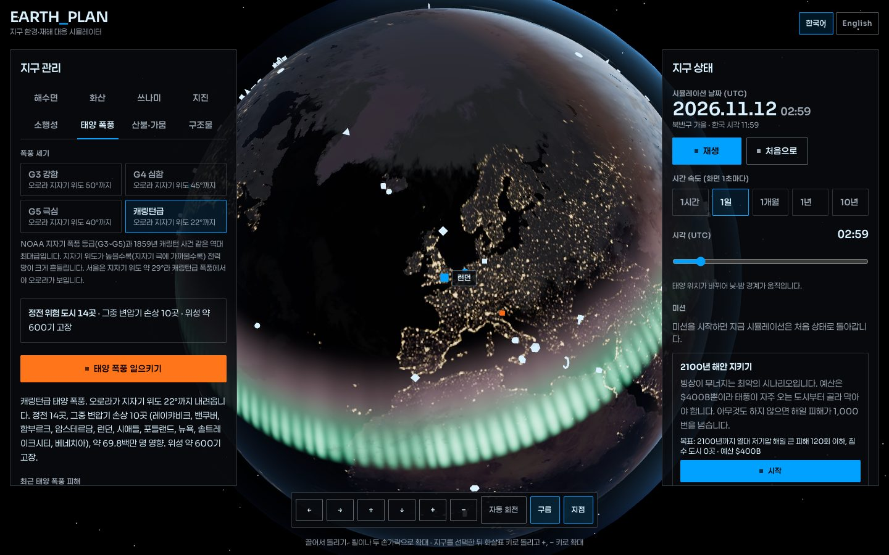 | 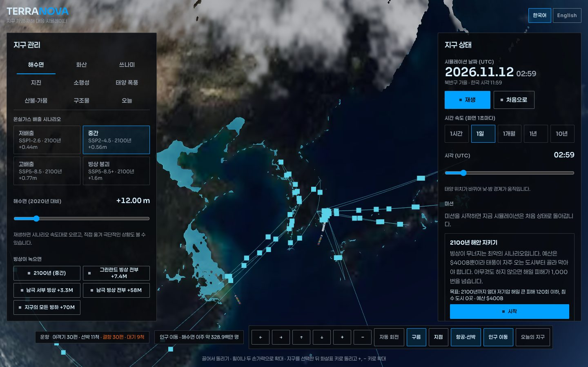 |

| 영어 화면 (캐스케이디아 쓰나미, 밤)                                                                                                    |
| -------------------------------------------------------------------------------------------------------------------------------------- |
| 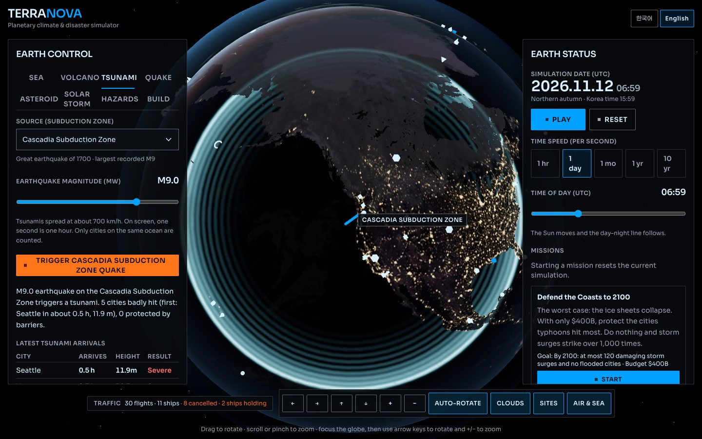 |

| 항공·선박 (동아시아, 지점 표시 끔)                                                                                         |
| -------------------------------------------------------------------------------------------------------------------------- |
| 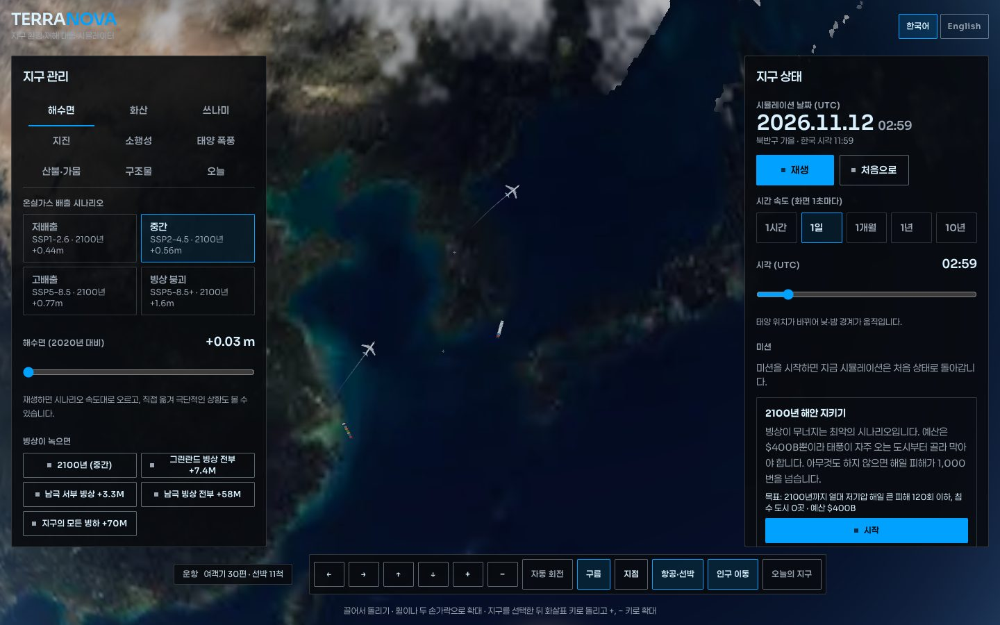 |

| 북아나톨리아 단층 규모 7.6 지진                                                                  | 모바일                                                                                                      |
| ------------------------------------------------------------------------------------------------ | ----------------------------------------------------------------------------------------------------------- |
| 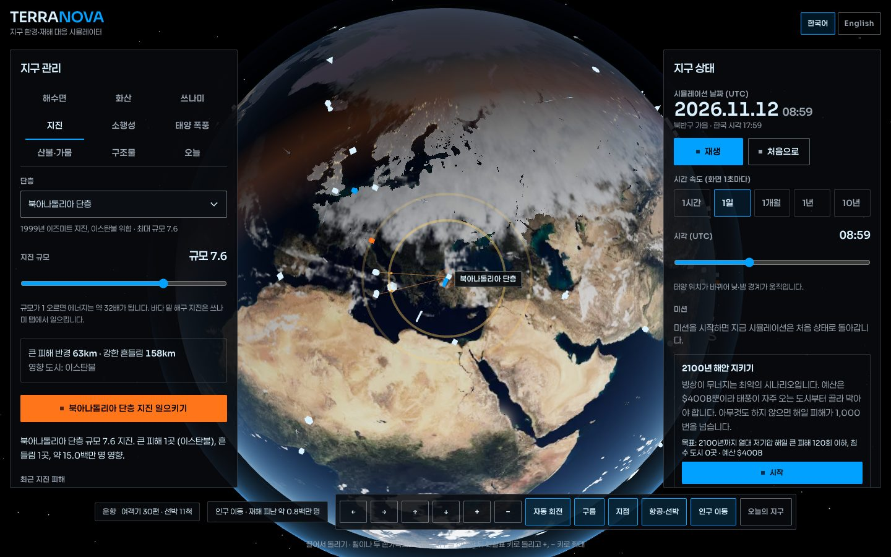 | 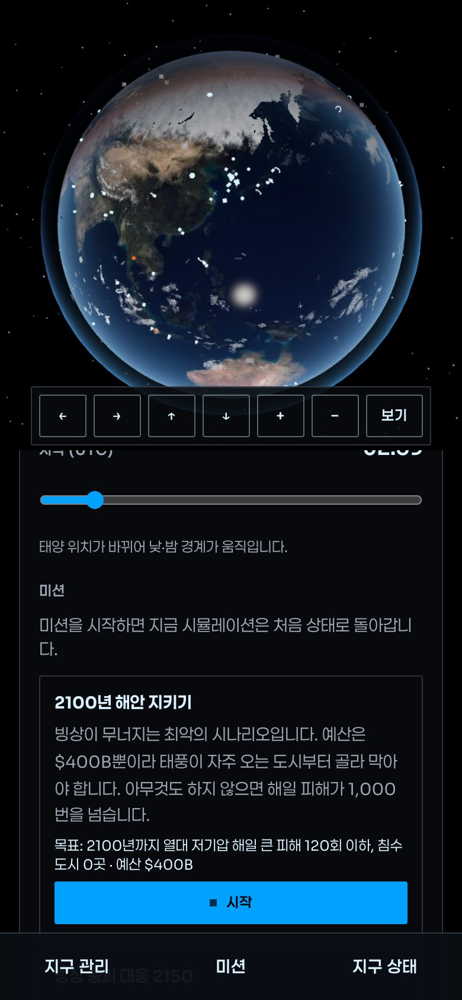 |

## 주요 기능

| 구분                  | 내용                                                                                                                                                                                                                                                                                                                                                                                                                                                                                                                  |
| --------------------- | --------------------------------------------------------------------------------------------------------------------------------------------------------------------------------------------------------------------------------------------------------------------------------------------------------------------------------------------------------------------------------------------------------------------------------------------------------------------------------------------------------------------- |
| 지구본                | 끌어서 돌리기(관성), 휠·핀치 확대, 화살표·`+`/`-` 키와 버튼으로 회전·확대, 자동 회전, 지점 선택 시 카메라 이동. 모바일은 지구를 위에 고정하고 아래 메뉴로 이동                                                                                                                                                                                                                                                                                                                                                        |
| 항공·선박             | 실제 노선을 본뜬 가상 운항(실시간 위치 자료는 쓰지 않음): 여객기 30편(15개 노선, 김포↔제주 포함)과 비행운, 항공모함 위를 도는 전투기 편대, 케네디에서 발사해 궤도를 돌고 착륙하는 우주왕복선, 크루즈선·컨테이너선·항공모함 11척과 물결. 화산재는 비켜 가고(구름 안 공항은 결항), G4 이상 태양 폭풍엔 극항로를 남쪽으로 돌리고 왕복선 발사를 미룸, 침수·지진·쓰나미·소행성 피해 도시는 결항·입항 대기, 배는 열대 저기압 반경에 들어가지 않음. 밤 쪽에서는 불빛, 지구 아래 운항 요약과 사건 기록, 보기 묶음에서 끄고 켬 |
| 시간·날씨             | 태양 위치로 낮·밤 경계와 밤의 도시 불빛, 계절별 적설선·해빙, 흐르는 구름, 열대 저기압(나선 구름)과 해안 도시 상륙·해일 피해                                                                                                                                                                                                                                                                                                                                                                                           |
| 기후                  | IPCC AR6 기반 배출 시나리오 4종, 온난화에 따른 해빙·적설 후퇴와 건조화, 큰 분화·충돌 뒤 몇 년간 기온 하강                                                                                                                                                                                                                                                                                                                                                                                                             |
| 해수면                | 시나리오 속도로 상승하거나 0~80m 직접 설정, 고도 자료로 잠긴 육지 표시·면적 계산, 도시 60곳(해안 48곳)의 침수·보호 상태. 한반도는 1분(약 1.8km) 고해상도 고도로 서해안·한강 하구까지 세밀하게                                                                                                                                                                                                                                                                                                                         |
| 화산·쓰나미           | 화산 16곳 VEI 4~8 분화(분출 기둥, 화산재), 섭입대 8곳 규모 7.5~9.5 지진(동심원 파면, 도시별 도달 표)                                                                                                                                                                                                                                                                                                                                                                                                                  |
| 지진                  | 활성 단층 8곳(양산·수도권 직하·북아나톨리아·샌안드레아스 등) 규모 5.5~8.5, 피해 반경과 도시별 피해, 지진파 고리                                                                                                                                                                                                                                                                                                                                                                                                       |
| 소행성                | 지름 50m~10km, 충돌 에너지·폭풍·열복사 반경, 바다에 떨어지면 충돌 쓰나미, 1km 이상은 충돌 겨울                                                                                                                                                                                                                                                                                                                                                                                                                        |
| 태양 폭풍             | G3·G4·G5·캐링턴급, 지자기 위도를 따라 저위도까지 내려오는 밤 오로라, 지자기 위도가 높은 도시의 정전·변압기 손상과 위성 고장                                                                                                                                                                                                                                                                                                                                                                                           |
| 산불·가뭄             | 지역 11곳, 탄 자리·불길·연기와 마른 땅 표시, 기온·가뭄에 따라 커지는 산불, 재생 중 저절로 나는 산불                                                                                                                                                                                                                                                                                                                                                                                                                   |
| 거대 구조물·정책 13종 | 방조제, 쓰나미 방벽, 해협 차단 댐, 빙하 해저 커튼, 마그마 감압 시추, L1 우주 차양, 행성 방위 요격망, 우주 기상 경보망, 공중 소방 거점, 해수 담수화·수로망, 도시 내진 보강, 직접 공기 포집망·재생에너지 전환(완공 뒤 수십 년에 걸쳐 기온·해수면 상승을 늦춤)                                                                                                                                                                                                                                                           |
| 지점 정보             | 고른 지점의 인구·고도·기존 방어·현재 상태, 화산·단층 기록, 그곳에 지은 구조물                                                                                                                                                                                                                                                                                                                                                                                                                                         |
| 저장·공유             | 시나리오를 주소에 담은 공유 링크 복사(메신저에 붙이면 미리보기 이미지), 이름 붙여 브라우저에 저장·불러오기·지우기                                                                                                                                                                                                                                                                                                                                                                                                     |
| 미션                  | 2100년 해안 지키기, 빙상 붕괴 대응 2150, 2032년 소행성 막기. 마지막 해에 판정하고 결과 대화상자(쓴 예산·피해·최종 상태, 결과 복사)                                                                                                                                                                                                                                                                                                                                                                                    |
| 추이                  | 해수면·평균 기온 그래프(마우스를 올리면 값)와 표                                                                                                                                                                                                                                                                                                                                                                                                                                                                      |
| 기록                  | 지구 상태 수치(해수면, 기온, 침수 도시, 이주 추정, 폭풍, 산불, 가뭄, 예산)와 사건 기록. 새 사건은 3초 단위로 묶어 화면 낭독기에 알림                                                                                                                                                                                                                                                                                                                                                                                  |
| 언어                  | 한국어·영어 전환(머리말 버튼, 브라우저에 기억), 지난 사건 기록까지 함께 바뀜, `<html lang>` 동기화                                                                                                                                                                                                                                                                                                                                                                                                                    |
| 빠른 첫 화면·설치     | 같은 시점에서 찍은 지구 정지 이미지를 먼저 보여 주고, three.js는 한가할 때 미리 받아 두었다가 첫 상호작용이나 5초 뒤에 그려 바꿈, 홈 화면에 설치(웹 앱 매니페스트), 서비스 워커가 코드·텍스처를 캐시해 다시 방문하면 바로 열림(배포마다 옛 캐시 정리), 작은 화면은 1024px 텍스처                                                                                                                                                                                                                                      |
| 없는 주소·오류        | 같은 디자인의 404 안내와 오류 화면(다시 시도·처음 화면으로), 배포 직후 옛 화면이 사라진 코드를 받지 못하면 한 번 새로고침                                                                                                                                                                                                                                                                                                                                                                                             |

## 기술 스택


| 구분       | 사용 기술                                                                                                                                                               |
| ---------- | ----------------------------------------------------------------------------------------------------------------------------------------------------------------------- |
| 프레임워크 | TanStack Start 1.169 (정적 사전 렌더링), TanStack Router, React 19, TypeScript 6                                                                                        |
| 3D         | three.js, React Three Fiber 9, drei, 직접 작성한 GLSL 셰이더                                                                                                            |
| 상태       | zustand                                                                                                                                                                 |
| 스타일     | Tailwind CSS 4, 웹 폰트(Sora, 페이퍼로지)                                                                                                                               |
| 품질       | ESLint, Prettier, Steiger(FSD 검사), Vitest + Testing Library·React Three Test Renderer, 스토리 테스트(Vitest 브라우저 모드 + axe), Playwright E2E + axe, Lighthouse CI |
| 문서       | Storybook 10 (`@storybook/react-vite`, a11y·Vitest 애드온)                                                                                                              |
| 배포·CI    | GitHub Pages, GitHub Actions                                                                                                                                            |

## 시작하기

Node.js 26(`.nvmrc`)과 pnpm 12가 필요합니다.

```bash
nvm use
corepack enable pnpm
pnpm install
pnpm dev    # http://localhost:3000
```

| 명령                                   | 설명                                                                                                   |
| -------------------------------------- | ------------------------------------------------------------------------------------------------------ |
| `pnpm build` / `pnpm preview`          | 정적 사이트 빌드(`dist/client`) / 빌드 결과 실행                                                       |
| `pnpm build:all`                       | 사이트와 Storybook을 함께 빌드 (하위 경로는 `BASE_PATH=/TerraNova/`)                                   |
| `pnpm lint` / `lint:fsd` / `typecheck` | ESLint / FSD 구조 검사 / 타입 검사                                                                     |
| `pnpm test`                            | 단위·컴포넌트 테스트 (jsdom, 3D 장면 포함)                                                             |
| `pnpm test:storybook`                  | 모든 스토리를 Chromium에서 렌더링하고 접근성 검사 (처음 한 번 `pnpm exec playwright install chromium`) |
| `pnpm test:e2e`                        | 프로덕션 빌드 E2E·접근성 검사 (먼저 `build` 필요)                                                      |
| `pnpm lighthouse`                      | Lighthouse CI 점수 검사 (먼저 `build` 필요)                                                            |
| `pnpm storybook`                       | Storybook 개발 서버 (`http://localhost:6006`)                                                          |
| `pnpm poster`                          | 지구본 정지 이미지 다시 찍기 (Storybook을 띄운 뒤)                                                     |
| `pnpm fonts`                           | 한글 웹 폰트 다시 만들기 (화면 글자를 바꾼 뒤)                                                         |
| `pnpm screenshots`                     | README 화면 다시 찍기 (`build:all` 뒤 `preview`를 띄운 다음 `BASE_URL` 지정)                           |

## 프로젝트 구조

```
e2e/                  E2E 테스트 (화면 폭, 접근성, 키보드, 3D 전환·WebGL 없음, 시뮬레이션·공유 흐름, 404·배포 파일)
public/textures/      지구 텍스처(WebP), 고도 텍스처(전 세계·한반도), 육지 고도 격자
scripts/              ETOPO1 → 고도 텍스처 변환(전 세계·한반도), 정지 이미지·README 화면 촬영, 한글 웹 폰트, 서비스 워커 캐시 버전
src/
├─ app/               전역 스타일, HTML 문서 틀, 오류 화면
├─ pages/simulator/   시뮬레이터 페이지 (FSD pages-first)
│  ├─ api/            육지 고도 격자 불러오기
│  ├─ lib/            지구·구름·대기 셰이더
│  ├─ model/          지점·구조물 데이터, 시뮬레이션 엔진·재해 계산·스토어, 저장·공유, 항공·선박 운항(traffic)
│  └─ ui/             지구본(globe), 제어판(panels), 상태판(status)
├─ pages/not-found/   없는 주소 안내 (404)
├─ shared/            공통 UI(버튼, 탭, 슬라이더, 안내 화면 등), 지리·천문·서식 유틸
└─ routes/            TanStack Router 라우트 (페이지를 다시 내보내기만 함)
```

## 문서

| 문서                                | 내용                                          |
| ----------------------------------- | --------------------------------------------- |
| [개발 가이드](docs/development.md)  | 구조, 시뮬레이션 모델, 셰이더, 테스트, 접근성 |
| [데이터 출처](docs/data-sources.md) | 고도·텍스처 자료와 라이선스, 변환 방법        |
| [성능](docs/performance.md)         | Lighthouse 측정 결과와 개선 내용              |
| [배포](docs/deployment.md)          | GitHub Pages 배포와 하위 경로 설정            |
| [버전 기록](CHANGELOG.md)           | 버전별 변경 내용                              |

## 웹 폰트

| 글꼴       | 쓰는 곳               | 굵기         | 저작자                                | 라이선스    | 원본                                                                                                                 |
| ---------- | --------------------- | ------------ | ------------------------------------- | ----------- | -------------------------------------------------------------------------------------------------------------------- |
| Sora       | 영문·숫자 (제목·본문) | 100~800 가변 | Jonathan Barnbrook, Julián Moncada    | SIL OFL 1.1 | [Google Fonts](https://fonts.google.com/specimen/Sora) · [sora-xor/sora-font](https://github.com/sora-xor/sora-font) |
| 페이퍼로지 | 한글 (제목·본문)      | 400·600·700  | 이주임(리디자인)·김도균(기획), 피티앤 | SIL OFL 1.1 | [배포처](https://www.freesentation.blog/paperlogyfont) · [눈누](https://noonnu.cc/font_page/1456)                    |

두 글꼴 모두 저장소에 넣어 같은 사이트에서 제공합니다(외부 글꼴 CDN 없음). 페이퍼로지는 화면에 쓰는 글자만 담은 작은 파일을 먼저 받고, 나머지 글자는 글자 묶음별 조각으로 나눠 그 글자를 쓸 때만 받습니다([개발 가이드](docs/development.md#웹-폰트)). 라이선스 전문은 `scripts/fonts/paperlogy/OFL.txt`에 있습니다.

## 출처

| 자료                                            | 저작자                            | 사용 허락                   | 원본                                                                                                                     |
| ----------------------------------------------- | --------------------------------- | --------------------------- | ------------------------------------------------------------------------------------------------------------------------ |
| 지구 색·불빛·구름 텍스처                        | three.js 기여자                   | MIT                         | [three.js 예제 텍스처](https://github.com/mrdoob/three.js/tree/r160/examples/textures/planets) (r160)                    |
| Orbit 아이콘 (파비콘·앱 아이콘, #1f6fb2로 칠함) | Skoll (game-icons.net)            | CC BY 3.0                   | [game-icons.net](https://game-icons.net/1x1/skoll/orbit.html) · [라이선스](https://creativecommons.org/licenses/by/3.0/) |
| 고도 자료 ETOPO1 (전 세계 1/6°, 한반도 1분)     | NOAA NGDC (Amante & Eakins, 2009) | 자유 이용·재배포, 보증 없음 | [NOAA CoastWatch ERDDAP `etopo180`](https://coastwatch.pfeg.noaa.gov/erddap/griddap/etopo180.html)                       |

인용 문헌, 파일별 구성과 변환 방법은 [데이터 출처](docs/data-sources.md)에 있습니다. 도시 고도·인구 등 대략값은 직접 정리했습니다.
