# EARTH_PLAN - 지구 환경·재해 대응 시뮬레이터

[](https://github.com/ryushin01/EARTH_PLAN/actions/workflows/ci.yml)


3D 지구 위에서 해수면 상승, 화산 분화, 쓰나미, 지진, 소행성 충돌, 산불·가뭄을 일으키고 해협 댐·우주 차양·행성 방위 요격망 같은 거대 구조물로 막아 보는 웹 시뮬레이터입니다.

**[데모 바로 보기](https://ryushin01.github.io/EARTH_PLAN/)** · [Storybook](https://ryushin01.github.io/EARTH_PLAN/storybook/)

> **프로젝트 상태:** 0.6.2까지 만든 **개인 프로젝트**입니다. 해수면 상승은 실제 고도 자료(NOAA ETOPO1)로 계산하지만, 도시 고도·인구·피해 규모는 대략값과 단순화한 모델이라 교육·탐색용으로만 쓰세요.

## 화면

| 첫 화면 (한국 정오)                                                                        | 해수면 +25m (남아시아)                                                                                  |
| ------------------------------------------------------------------------------------------ | ------------------------------------------------------------------------------------------------------- |
| 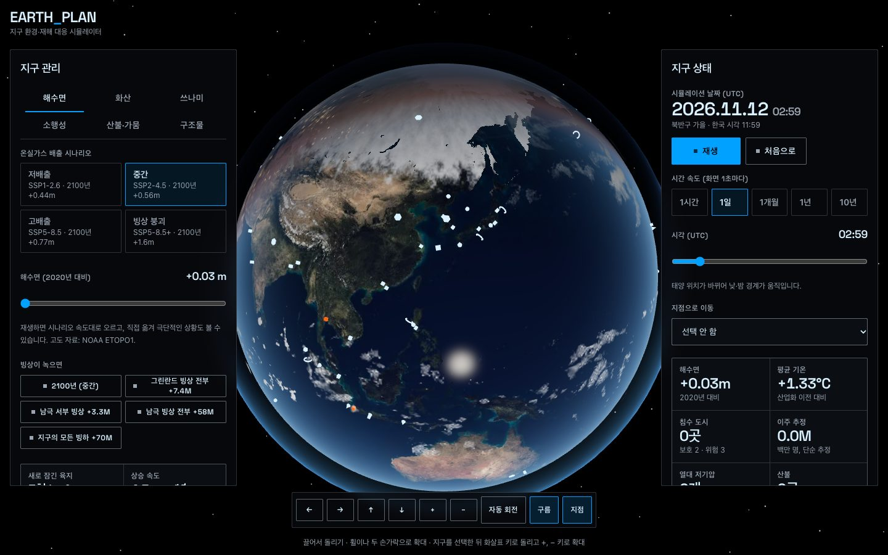 | 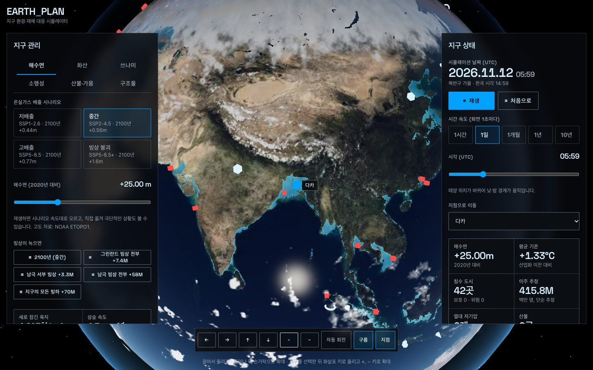 |

| 일본 해구 쓰나미                                                                                           | 백두산 VEI 7 분화 (밤)                                                                                       |
| ---------------------------------------------------------------------------------------------------------- | ------------------------------------------------------------------------------------------------------------ |
| 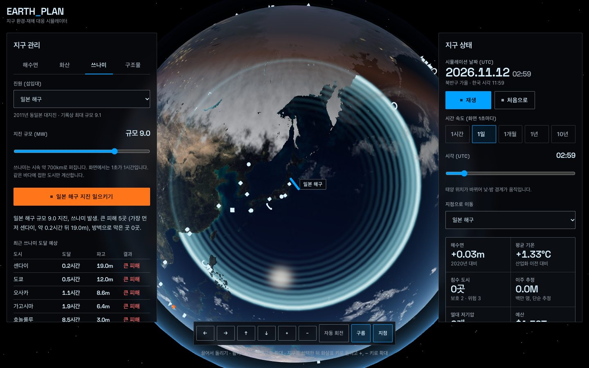 | 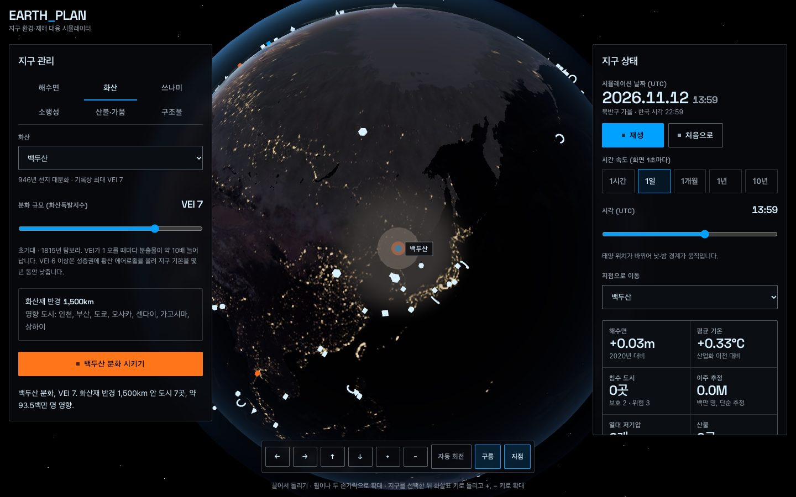 |

| 북대서양 소행성 충돌 (지름 1km)                                                                          | 캘리포니아 극심 가뭄과 산불 (밤)                                                          |
| -------------------------------------------------------------------------------------------------------- | ----------------------------------------------------------------------------------------- |
| 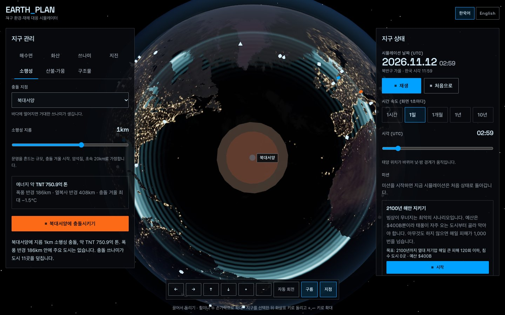 | 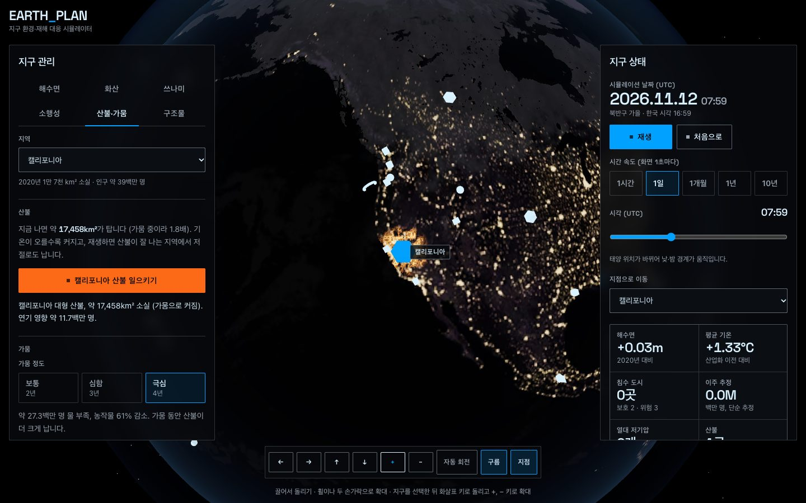 |

| 북해 차단 댐 건설                                                                                   | 빙상 붕괴 미션과 추이 그래프                                                                               |
| --------------------------------------------------------------------------------------------------- | ---------------------------------------------------------------------------------------------------------- |
| 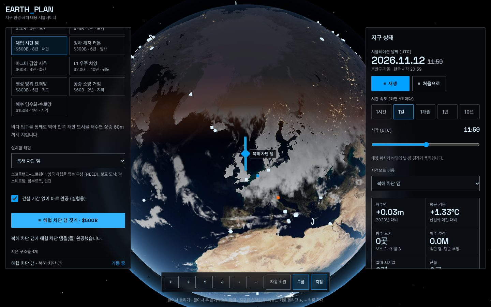 | 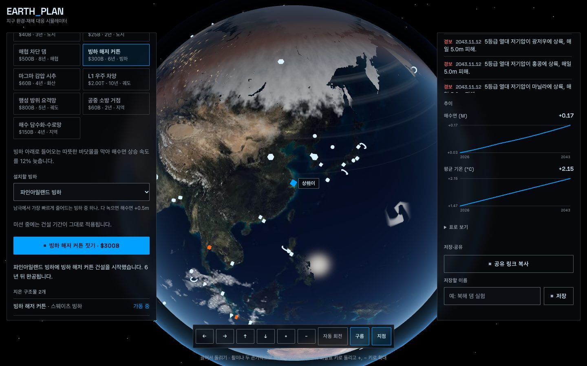 |

| 영어 화면 (캐스케이디아 쓰나미, 밤)                                                                                                    |
| -------------------------------------------------------------------------------------------------------------------------------------- |
| 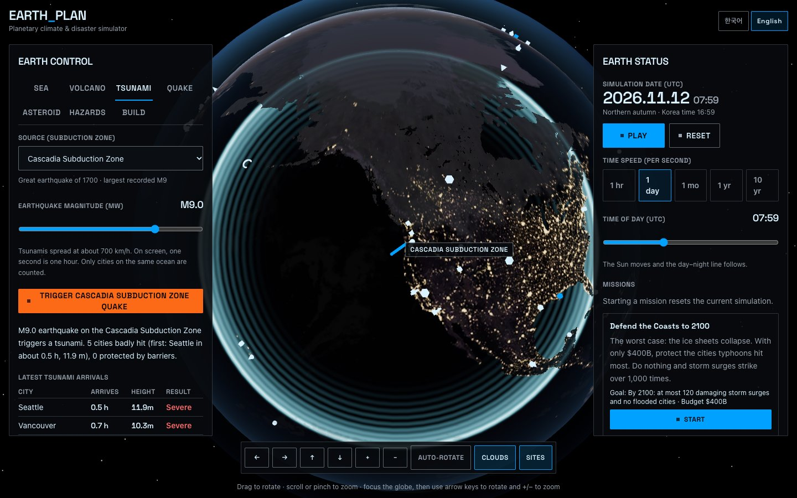 |

| 북아나톨리아 단층 규모 7.6 지진                                                                  | 모바일                                                                                                      |
| ------------------------------------------------------------------------------------------------ | ----------------------------------------------------------------------------------------------------------- |
| 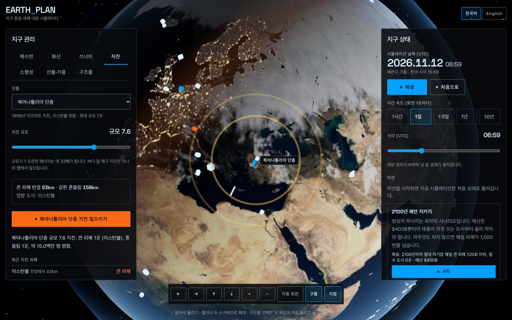 | 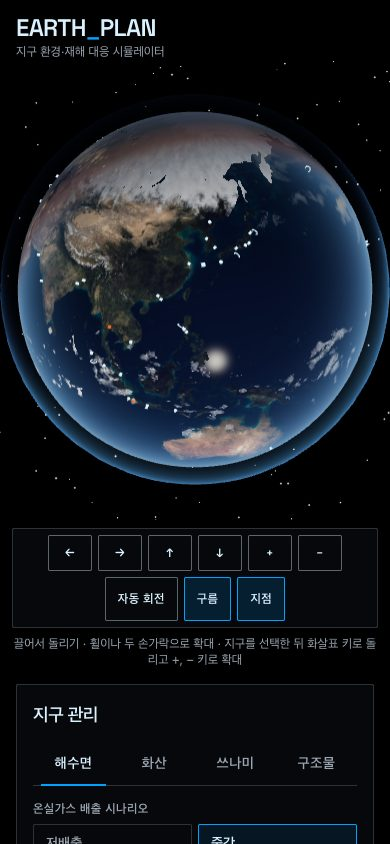 |

## 주요 기능

| 구분                  | 내용                                                                                                                                                                                                                                      |
| --------------------- | ----------------------------------------------------------------------------------------------------------------------------------------------------------------------------------------------------------------------------------------- |
| 지구본                | 끌어서 돌리기(관성), 휠·핀치 확대, 화살표·`+`/`-` 키와 버튼으로 회전·확대, 자동 회전, 지점 선택 시 카메라 이동. 모바일은 지구를 위에 고정하고 아래 메뉴로 이동                                                                            |
| 시간·날씨             | 태양 위치로 낮·밤 경계와 밤의 도시 불빛, 계절별 적설선·해빙, 흐르는 구름, 열대 저기압(나선 구름)과 해안 도시 상륙·해일 피해                                                                                                               |
| 기후                  | IPCC AR6 기반 배출 시나리오 4종, 온난화에 따른 해빙·적설 후퇴와 건조화, 큰 분화·충돌 뒤 몇 년간 기온 하강                                                                                                                                 |
| 해수면                | 시나리오 속도로 상승하거나 0~80m 직접 설정, 고도 자료로 잠긴 육지 표시·면적 계산, 도시 50곳(해안 42곳)의 침수·보호 상태                                                                                                                   |
| 화산·쓰나미           | 화산 16곳 VEI 4~8 분화(분출 기둥, 화산재), 섭입대 8곳 규모 7.5~9.5 지진(동심원 파면, 도시별 도달 표)                                                                                                                                      |
| 지진                  | 활성 단층 8곳(양산·수도권 직하·북아나톨리아·샌안드레아스 등) 규모 5.5~8.5, 피해 반경과 도시별 피해, 지진파 고리                                                                                                                           |
| 소행성                | 지름 50m~10km, 충돌 에너지·폭풍·열복사 반경, 바다에 떨어지면 충돌 쓰나미, 1km 이상은 충돌 겨울                                                                                                                                            |
| 산불·가뭄             | 지역 11곳, 탄 자리·불길·연기와 마른 땅 표시, 기온·가뭄에 따라 커지는 산불, 재생 중 저절로 나는 산불                                                                                                                                       |
| 거대 구조물·정책 12종 | 방조제, 쓰나미 방벽, 해협 차단 댐, 빙하 해저 커튼, 마그마 감압 시추, L1 우주 차양, 행성 방위 요격망, 공중 소방 거점, 해수 담수화·수로망, 도시 내진 보강, 직접 공기 포집망·재생에너지 전환(완공 뒤 수십 년에 걸쳐 기온·해수면 상승을 늦춤) |
| 지점 정보             | 고른 지점의 인구·고도·기존 방어·현재 상태, 화산·단층 기록, 그곳에 지은 구조물                                                                                                                                                             |
| 저장·공유             | 시나리오를 주소에 담은 공유 링크 복사, 이름 붙여 브라우저에 저장·불러오기·지우기                                                                                                                                                          |
| 미션                  | 2100년 해안 지키기, 빙상 붕괴 대응 2150, 2032년 소행성 막기. 마지막 해에 판정하고 결과 대화상자(쓴 예산·피해·최종 상태, 결과 복사)                                                                                                        |
| 추이                  | 해수면·평균 기온 그래프(마우스를 올리면 값)와 표                                                                                                                                                                                          |
| 기록                  | 지구 상태 수치(해수면, 기온, 침수 도시, 이주 추정, 폭풍, 산불, 가뭄, 예산)와 사건 기록                                                                                                                                                    |
| 언어                  | 한국어·영어 전환(머리말 버튼, 브라우저에 기억), 지난 사건 기록까지 함께 바뀜, `<html lang>` 동기화                                                                                                                                        |
| 설치·오프라인         | 홈 화면에 설치(웹 앱 매니페스트), 서비스 워커가 코드·텍스처를 캐시해 다시 방문하면 바로 열림, 작은 화면은 1024px 텍스처                                                                                                                   |

## 기술 스택


| 구분       | 사용 기술                                                                                          |
| ---------- | -------------------------------------------------------------------------------------------------- |
| 프레임워크 | TanStack Start 1.169 (정적 사전 렌더링), TanStack Router, React 19, TypeScript 6                   |
| 3D         | three.js, React Three Fiber 9, drei, 직접 작성한 GLSL 셰이더                                       |
| 상태       | zustand                                                                                            |
| 스타일     | Tailwind CSS 4, Space Grotesk                                                                      |
| 품질       | ESLint, Prettier, Steiger(FSD 검사), Vitest + Testing Library, Playwright E2E + axe, Lighthouse CI |
| 문서       | Storybook 10 (`@storybook/react-vite`, a11y 애드온)                                                |
| 배포·CI    | GitHub Pages, GitHub Actions                                                                       |

## 시작하기

Node.js 26(`.nvmrc`)과 pnpm 12가 필요합니다.

```bash
nvm use
corepack enable pnpm
pnpm install
pnpm dev    # http://localhost:3000
```

| 명령                                   | 설명                                                                  |
| -------------------------------------- | --------------------------------------------------------------------- |
| `pnpm build` / `pnpm preview`          | 정적 사이트 빌드(`dist/client`) / 빌드 결과 실행                      |
| `pnpm build:all`                       | 사이트와 Storybook을 함께 빌드 (하위 경로는 `BASE_PATH=/EARTH_PLAN/`) |
| `pnpm lint` / `lint:fsd` / `typecheck` | ESLint / FSD 구조 검사 / 타입 검사                                    |
| `pnpm test`                            | 단위·컴포넌트 테스트                                                  |
| `pnpm test:e2e`                        | 프로덕션 빌드 E2E·접근성 검사 (먼저 `build` 필요)                     |
| `pnpm lighthouse`                      | Lighthouse CI 점수 검사 (먼저 `build` 필요)                           |
| `pnpm storybook`                       | Storybook 개발 서버 (`http://localhost:6006`)                         |

## 프로젝트 구조

```
e2e/                  E2E 테스트 (화면 폭, 접근성, 키보드, 시뮬레이션·공유 흐름)
public/textures/      지구 텍스처(WebP), 고도 텍스처, 육지 고도 격자
scripts/              ETOPO1 → 고도 텍스처 변환 스크립트
src/
├─ app/               전역 스타일, HTML 문서 틀
├─ pages/simulator/   시뮬레이터 페이지 (FSD pages-first)
│  ├─ api/            육지 고도 격자 불러오기
│  ├─ lib/            지구·구름·대기 셰이더
│  ├─ model/          지점·구조물 데이터, 시뮬레이션 엔진·재해 계산·스토어, 저장·공유
│  └─ ui/             지구본(globe), 제어판(panels), 상태판(status)
├─ shared/            공통 UI(버튼, 탭, 슬라이더 등), 지리·천문·서식 유틸
└─ routes/            TanStack Router 라우트 (페이지를 다시 내보내기만 함)
```

## 문서

| 문서                                | 내용                                          |
| ----------------------------------- | --------------------------------------------- |
| [개발 가이드](docs/development.md)  | 구조, 시뮬레이션 모델, 셰이더, 테스트, 접근성 |
| [데이터 출처](docs/data-sources.md) | 고도·텍스처 자료와 라이선스, 변환 방법        |
| [성능](docs/performance.md)         | Lighthouse 측정 결과와 개선 내용              |
| [배포](docs/deployment.md)          | GitHub Pages 배포와 하위 경로 설정            |
| [버전 기록](CHANGELOG.md)           | 버전별 변경 내용                              |

## 출처

| 자료                     | 저작자                            | 사용 허락                   | 원본                                                                                                  |
| ------------------------ | --------------------------------- | --------------------------- | ----------------------------------------------------------------------------------------------------- |
| Space Grotesk 글꼴       | The Space Grotesk Project Authors | SIL OFL 1.1                 | [floriankarsten/space-grotesk](https://github.com/floriankarsten/space-grotesk)                       |
| 지구 색·불빛·구름 텍스처 | three.js 기여자                   | MIT                         | [three.js 예제 텍스처](https://github.com/mrdoob/three.js/tree/r160/examples/textures/planets) (r160) |
| 고도 자료 ETOPO1         | NOAA NGDC (Amante & Eakins, 2009) | 자유 이용·재배포, 보증 없음 | [NOAA CoastWatch ERDDAP `etopo180`](https://coastwatch.pfeg.noaa.gov/erddap/griddap/etopo180.html)    |

인용 문헌, 파일별 구성과 변환 방법은 [데이터 출처](docs/data-sources.md)에 있습니다. 도시 고도·인구 등 대략값은 직접 정리했습니다.
